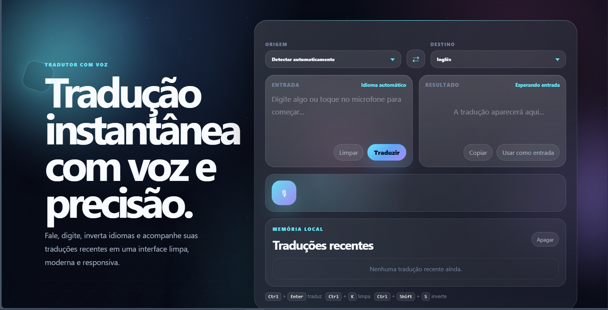
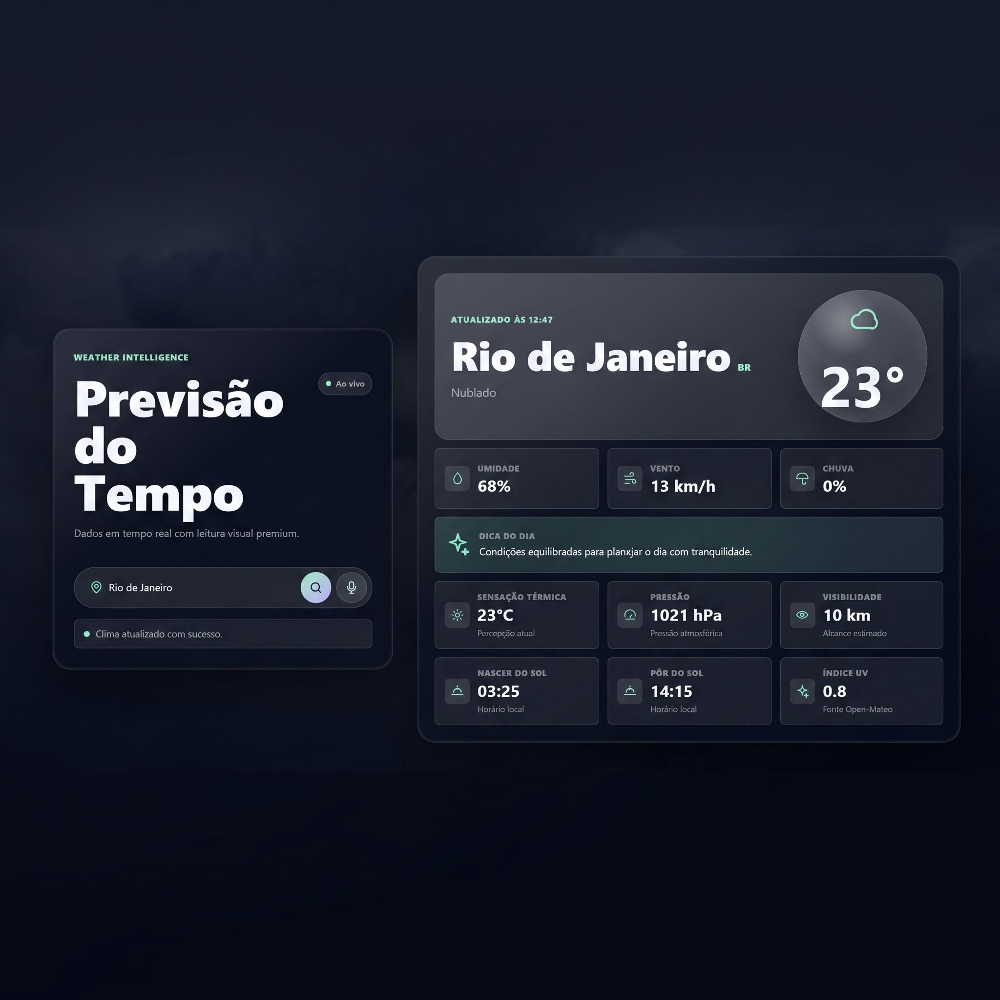
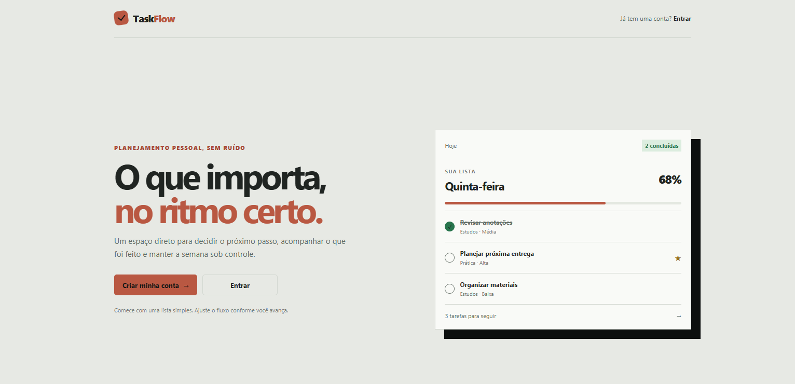

# Sabrina Ferreira | Full Stack Developer

  

  

  
  
  

---

## About Me

Desenvolvedora Full Stack e estudante de Engenharia de Software, com foco no desenvolvimento de aplicações web modernas e soluções completas.

Minha evolução é baseada em disciplina, consistência e prática constante, sempre desenvolvendo projetos próprios para consolidar conhecimento e resolver problemas reais.

Atualmente, estou aprofundando meus conhecimentos em desenvolvimento Full Stack, arquitetura backend e construção de aplicações escaláveis.

---

## ⚡ Tech Stack

### Frontend

---

### Backend

---

### Database & ORM

---

### Tools

---

### Currently Exploring

---

## 🚀 Featured Projects

<table>
<tr>
<td width="50%" valign="top">

### 🌐 Tradutor IA

Aplicação de tradução com recursos de inteligência artificial, desenvolvida para oferecer uma experiência interativa e facilitar a tradução de textos.

**Stack**

`JavaScript` `HTML` `CSS` `REST API`

  
  

</td>
<td width="50%" valign="top">

### 🌤️ Weather Forecast

Aplicação de previsão do tempo com consulta de condições meteorológicas em tempo real por meio de uma API externa.

**Stack**

`React` `JavaScript` `CSS` `REST API`

  
  

</td>
</tr>
<tr>
<td width="50%" valign="top">

### 📋 TaskFlow

Aplicação Full Stack de gerenciamento de tarefas, com funcionalidades para organizar atividades, definir prioridades e acompanhar seu andamento. Integra frontend, backend e banco de dados PostgreSQL.

**Stack**

`React` `TypeScript` `Context API` `Node.js` `Express` `PostgreSQL` `Prisma` `Zod`

  
  

</td>
<td width="50%" valign="top">

### 💡 Development Focus

- Full Stack Development
- REST API Development
- Frontend Architecture
- Backend Architecture
- Database Modeling
- Component-Based Development
- Responsive Interfaces
- Code Organization
- CRUD Applications
- Software Engineering

</td>
</tr>
</table>

---

## 🔥 Contribution Streak

---

## 🐍 Contribution Graph

---

## 🎯 Current Goals

- Building complete Full Stack applications.
- Improving backend architecture and API design.
- Deepening knowledge of software engineering.
- Exploring Docker and cloud infrastructure.
- Developing projects with real-world applications.

---

## 🌐 Let's Connect

  

  <i>Building. Learning. Improving. One project at a time.</i>

